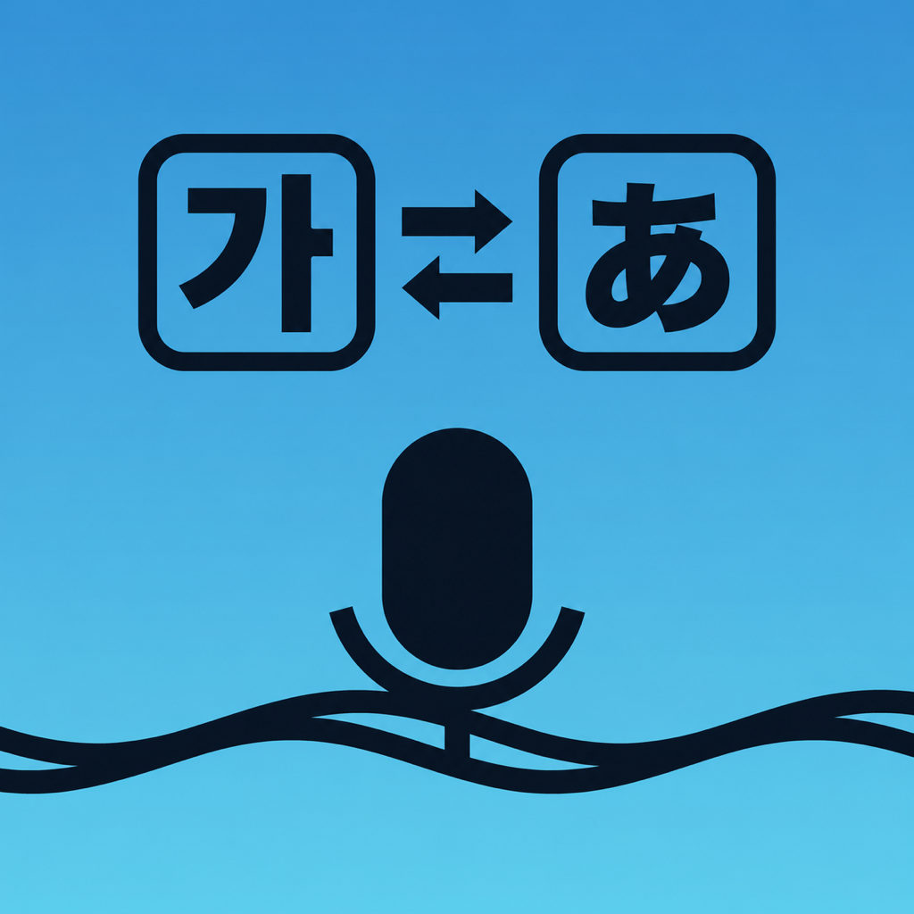

# BridgeTTS Korean



日本語↔韓国語の音声翻訳アプリです。OpenAI API（gpt-4.1-nano）で翻訳し、端末の音声で読み上げます。iOSネイティブ版とPWAのコードを共通化しています。

## AltStoreでインストール

**AltStore Classicを使用します。** 韓国語版v2.9.4の未署名IPAを配布します。英語版とは別アプリとしてインストールできます。

1. iPhoneのSafariで[AltStore登録ページ](https://aichirofunakoshi.github.io/BrigeTTS-Korean/altstore.html)を開き、「AltStoreにソースを追加」をタップします。
2. またはAltStoreのSources → ＋に `https://aichirofunakoshi.github.io/BrigeTTS-Korean/apps.json` を登録します。
3. Browseから **BridgeTTS Korean → FREE** を選択してインストールします。
4. 初回起動時にマイク・音声認識を許可し、設定にOpenAI APIキーを入力します。

ソース登録後は、韓国語版の新しいリリースをAltStoreで受け取れます。IPAを手動で取り込む場合は次の手順です。

1. Mac/PCに[AltServer](https://altstore.io/)を導入し、iPhoneにAltStore Classicをインストールします。
2. GitHubにログインし、[iOSビルド一覧](https://github.com/AichiroFunakoshi/BrigeTTS-Korean/actions/workflows/ios-build.yml)から最新の成功した実行を開きます。
3. Artifactsの`BridgeTTS-unsigned-ipa`をダウンロードし、ZIPを展開して`BridgeTTS-unsigned.ipa`を取り出します。
4. IPAをAirDropなどでiPhoneへ転送します。AltServerが動作するMac/PCとiPhoneを接続してください。
5. iPhoneのAltStoreで **My Apps → ＋ → IPAを選択** し、自分のApple IDで署名・インストールします。
6. 初回起動時にマイク・音声認識を許可し、設定画面にOpenAI APIキーを入力します。

MacでIPAをダブルクリックする方法ではインストールできません。iOS 16以降ではデベロッパモードの有効化が必要です。無料Apple IDでは7日ごとの署名更新と同時3アプリの制限があります。[AltStore公式ガイド](https://faq.altstore.io/altstore-classic/your-altstore)

手動導入時の更新は新しいIPAを同じ方法でインストールします。韓国語版のbundle IDは`com.a16.bridgetts.korean`で、英語版と併用できます。韓国語版の設定・辞書・履歴は英語版から独立しています。更新前に設定エクスポートでバックアップできます（APIキー・会話履歴はエクスポート対象外）。

## ソースからの自動配布・PWA

リポジトリは公開し、GitHub PagesをActions配信に設定しています。IPA付きReleaseからAltStoreソースを生成します。

配信URL:

- AltStore登録ページ: `https://aichirofunakoshi.github.io/BrigeTTS-Korean/altstore.html`
- AltStoreソース: `https://aichirofunakoshi.github.io/BrigeTTS-Korean/apps.json`
- PWA: [ブラウザで開く](https://aichirofunakoshi.github.io/BrigeTTS-Korean/)

## 必要なもの・確認状況

- iOS 16以降、AltStore Classic/AltServer、OpenAI APIキー、インターネット接続。
- 韓国語TTSには端末の韓国語音声（ko-KR）が必要です。読み上げできない場合はiPhoneの音声設定で韓国語音声を確認してください。
- APIキーはアプリ内に保存され、翻訳時にOpenAIへ直接送信されます。リポジトリには保存しません。
- IPAビルドとバンドル内容を確認済み。iPhoneへの実インストール、音声認識・TTSの実機動作、実API翻訳品質は未確認です。コピー元英語版の品質数値は韓国語版の結果ではありません。

詳しい[インストール・ビルド手順](docs/IOS_APP.md)、[更新履歴](CHANGELOG.md)、[作業引継ぎ](docs/HANDOFF.md)も参照してください。

## 主な機能

- **リアルタイム音声翻訳**: 日本語⇄韓国語の双方向翻訳。話しながらストリーミングで翻訳結果を表示
- **順送り翻訳（石畳方式・既定）**: 発話の確定セグメントごとに前から訳を積み上げる凍結方式（確定訳は組み変わらない）。録音停止時に整形パスが原文全体と突き合わせて誤訳・訳抜けを修正する。従来の「標準（全文再翻訳）」も設定から選択可（フォールバック用）
- **音声認識の誤り補正**: 同音異義語の誤変換や助詞の欠落を、翻訳時に文脈から推定して修正
- **翻訳モード（会話領域スイッチ）**: 「医療・介護・福祉／日常会話」を設定で切替。領域に応じた翻訳方針をプロンプトに注入
- **ユーザー辞書**: 施設名・人名などの固有名詞（よみ／表記／韓国語表記）を端末内に登録。音声認識が別語に書き起こす固有名詞は「誤認識される表記」の登録で認識段階から決定的に置換
- **TTS（音声読み上げ）**: 翻訳ボックスをタップで再生/停止。設定でON/OFF・速度（×0.8〜×1.2）・日本語の読み上げ音声を調整可能
- **会話モード（オプション）**: 音声入力の停止後、最後の翻訳結果を自動で読み上げ（デフォルトOFF。対面会話でタップの手間を削減）
- **ターン制の会話フロー**: TTS実行＝1ターンの終了として音声入力を自動停止。次の入力は言語ボタンから開始（TTS後の認識再開による冒頭欠け・精度低下を防止し、日韓の言語切替も自然に）。30秒間無音の場合も自動停止（電池・発熱対策）
- **会話履歴**: 直近20件をヘッダーの履歴ボタンから専用画面で閲覧。各エントリの再生・コピー、全消去に対応。端末内（localStorage）にのみ保存
- **デバウンス最適化（学習型）**: デフォルト値（日本語346ms/韓国語346ms（暫定））から、音声認識の更新間隔を学習して翻訳開始の待ち時間を言語別に自己最適化（90パーセンタイル×1.2）。日韓は独立しており、片方の言語が30件に達すればその言語だけで最適化可能
- **テーマ切替**: 自動（端末設定に追従）/ライト/ダーク
- **フォントサイズ調整**: 小/中/大/特大の4段階
- **レスポンシブレイアウト**: 横画面では原文と翻訳を左右並列表示
- **視覚的状態フィードバック**: 録音中（青）/翻訳中（オレンジ）/完了（緑）を色で表示
- **設定のエクスポート/インポート**: ユーザー辞書・翻訳モード・デバウンス学習値・表示設定をJSON一括でコピー/貼り付けし、別端末へ移行可能
- **API使用量の表示**: 翻訳ごとのトークン数を端末内で累計し、設定画面に概算コスト（gpt-4.1-nano料金基準）を表示。レイテンシ統計の1タップ送信にも対応
- **エラー報告**: エラー発生時に「⚠️ エラーを報告」ボタンが出現。専用の報告トークン未設定時はGitHubのIssue下書き画面を開く（GitHubアカウントが必要・APIキー等は自動マスク）。録音中のフリーズ→強制終了もハートビートで検出し、次回起動時に直前ログ付きで報告可能

## iOSネイティブアプリの仕組み

WKWebViewでWebアプリ本体をそのまま動かし、WKWebViewに存在しない音声認識（webkitSpeechRecognition）をネイティブの `SFSpeechRecognizer` ブリッジ（`native-speech.js` + Swift）で補完しています。Webアプリ本体は両環境で共通です。

- `v*` タグのpushで、GitHub Actionsが未署名IPAをビルドしReleaseに添付
- 公開リポジトリでPages設定済みの場合、AltStoreソース（apps.json）を公開して更新を配信する

韓国語TTSは端末の韓国語音声を利用します。利用端末の音声一覧に`ko-KR`が必要です。英語版とは設定・辞書・履歴を分離しているため、韓国語版でもAPIキーを設定してください。

## 開発

```bash
git clone https://github.com/AichiroFunakoshi/BrigeTTS-Korean.git
cd BrigeTTS-Korean

# Node 22を使用（Playwright 1.60はNode 24/25で不安定なため）
nvm use  # .nvmrc準拠。Homebrewの場合: export PATH="/opt/homebrew/opt/node@22/bin:$PATH"

npm ci
npx playwright install chromium
npm run test:smoke -- --reporter=line
```

ローカル確認は `python3 -m http.server 4173` などで配信して `http://127.0.0.1:4173` を開きます（マイクを使う場合はHTTPSまたはlocalhostが必要）。iOSアプリのローカルビルドは [docs/IOS_APP.md](docs/IOS_APP.md) を参照してください。

### リリース手順

1. `package.json` / `package-lock.json`、`ios/project.yml` の `MARKETING_VERSION`、`index.html` のバージョン表記（タイトル・フッター）、`tests/smoke.test.js` の期待値を更新
2. `CHANGELOG.md` に変更内容を記録
3. PRをmainへマージ後、`git tag vX.Y.Z && git push origin vX.Y.Z`
4. IPAビルド → Release添付。公開リポジトリかつPages設定済みならAltStoreソースも更新（非公開時は手動IPAインストール）

### 主要ファイル

| ファイル | 役割 |
|---|---|
| `app.js` | アプリ本体（音声認識制御・翻訳トリガー・UI） |
| `translator-service.js` | OpenAI API（gpt-4.1-nano）ストリーミング翻訳 |
| `prompt-service.js` | 翻訳システムプロンプト（誤認識の文脈修正ルールを含む） |
| `tts-service.js` | 音声読み上げ（ネイティブ時はオーディオセッション切替＋ウォームアップ） |
| `native-speech.js` | iOSネイティブ音声認識ブリッジ（Web側） |
| `error-reporter.js` | エラー収集・マスク・GitHub Issues報告 |
| `ios/` | Swiftソース・XcodeGen設定・ビルドスクリプト |
| `altstore/generate_source.py` | AltStoreソース(apps.json)とPagesサイトの生成 |

## ブラウザ対応（PWA）

- iOS Safari / Android Chrome / Edge: 対応
- Firefox Mobile: 非対応（Web Speech API非搭載）

日韓評価は `node eval/run-eval.js --dry-run` と `--monotonic --dry-run` で構成検証できます。実翻訳の品質評価はAPIキーが必要で未実施です。コピー元の英語評価データは `eval/cases-english.json` と `eval/cases-monotonic-english.json` に保存しています。

## 既知の制限

- 翻訳にはインターネット接続とOpenAI APIキーが必要（使用量に応じてAPI料金が発生）
- 対応言語ペアは日本語⇄韓国語のみ
- 無料Apple IDでのサイドロードは7日ごとの再署名（AltStoreが自動更新）と3アプリ制限あり
